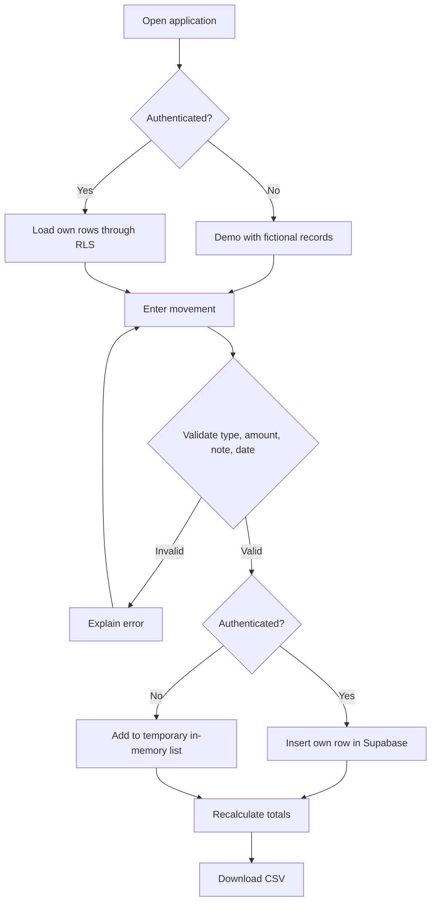
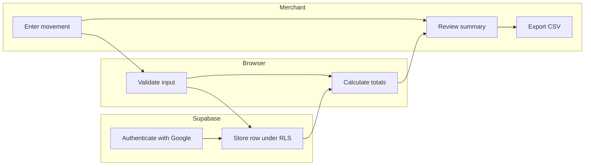

# FINANCIAL EVIDENCE PASSPORT — PRODUCT CHARTER + PACKET
Version 0.1 · Week 12 · MONEY lens · 2026-11-01

## Problem and exact user
A Mexican informal or thin-file micro-merchant has sales and expense records scattered across notebooks and chats. When asked to explain cash flow, organizing the evidence is slow and error-prone. First user: an adult market-stall merchant who can enter four fields on a smartphone. This is a hypothesis, not a claim of completed customer interviews.

## Core promise and success definition
Before the module closes, a user can enter an income or expense, see totals recalculate, and export a CSV with their entries at a live URL. In authenticated mode, each account accesses only its own entries. A demo mode with fictional records works without credentials.

## Product charter — what cannot change
We organize self-reported financial evidence; we do NOT verify income, assess creditworthiness, promise loan approval, or transmit documents to lenders. One core loop: record -> summarize -> export. User consent, data minimization and clarity outrank feature count. If an assumption fails, reduce scope rather than add AI theater.

## Screen mockup (wireframe — not a generated image)
[ EVIDENCIA | Tu trabajo merece pruebas ]
[ INGRESOS $1,950 ] [ GASTOS $240 ] [ BALANCE $1,710 ]
[ Registrar movimiento ]  [ Mi evidencia                  ]
[ Tipo: Ingreso       ]  [ Fecha | Concepto | Tipo | Monto ]
[ Monto: 850          ]  [ 10/28 | Venta... | Ing. | $850 ]
[ Descripción: Venta  ]  [ Descargar CSV                ]
[ Fecha: 2026-10-28   ]
[ AGREGAR MOVIMIENTO  ]

## Core flow (Mermaid)

## Actor swimlane (Mermaid)

## Benchmark
Benchmark to investigate: QuickBooks' transaction categorization and reports for small businesses. This MVP differs by restricting the task to a Spanish-first, four-field self-reported ledger for Mexican thin-file merchants. Benchmark comparison is directional and requires research validation.

## Three-year view
If the slice works, the product becomes a portable, user-controlled record of microbusiness cash flow. It may add opt-in evidence attachments and verification partnerships only after trust and consent are proven. Its long-term advantage would be traceability, not a black-box credit score.

## Scope cut
NO credit scoring, AI-generated financial advice, bank integrations, document OCR, loan recommendations, admin dashboards, messaging or payments. No synthetic outputs are passed off as verified facts.

## Architecture + stack
| Layer | Technology | Purpose |
|---|---|---|
| UI | Next.js / React / Tailwind | Responsive mobile-first form and summary |
| Hosting | Vercel | Live URL and preview deployments |
| Versioning | GitHub | Traceable commits |
| Auth | Supabase Google OAuth | Account sign-in |
| Data | Supabase Postgres with RLS | User-isolated movements |
| Export | Browser CSV | Download without server secrets |

## Security floor
Never commit .env.local; only publish Supabase anon key, never service role. Auth required for saved records. RLS enabled. Frontend and database enforce type/range/length constraints. Demo uses invented data labeled as such. No real personal data in seeds.

## Test plan and acceptance criteria
1. Load page on mobile and desktop; all controls visible.
2. Demo displays three explicitly fictional rows and correct totals (1950 income, 240 expense, 1710 net).
3. Add valid income 100: income becomes 2050; CSV contains it.
4. Reject negative amount and 101-character note with visible errors.
5. After configuring Supabase, Google login creates a session; saved rows remain after reload; another user cannot read them (RLS).
6. Run `npm test`, `npm run build`; inspect deployment; document one real discovered bug, correction, and redeployment.

## Milestone evidence status
Local unit tests: passed (3). Live URL, real domain, two deploys, five remote commits, OAuth integration test, persona screenshot walkthrough, video and shadow-clause compliance: NOT YET VERIFIED. The Crystal Ball Brief was not provided; its override conditions remain unknown.
